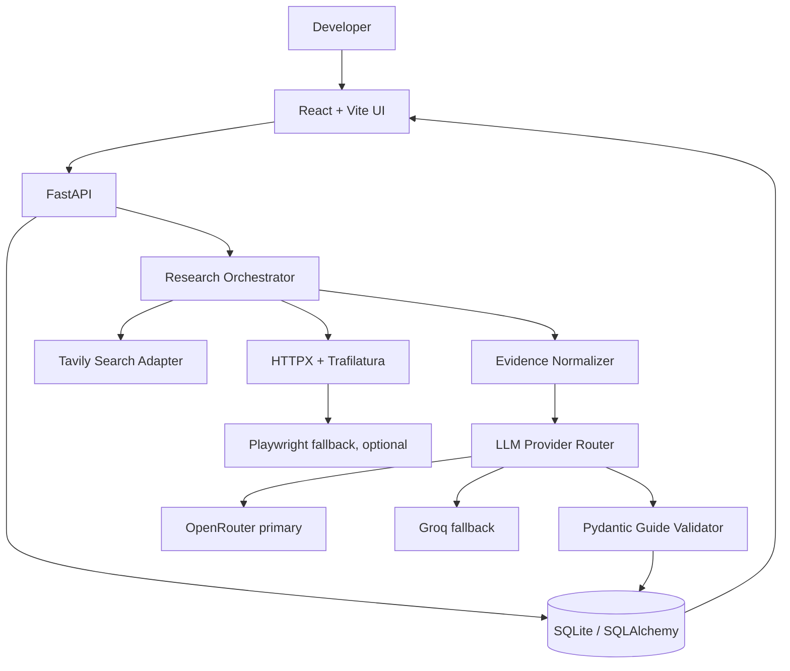

# System Architecture

## 1. High-level architecture

## 2. Runtime paths

### A. Browse a seeded guide

1. Frontend requests `GET /api/apps`.
2. Backend queries seeded `apps` records.
3. User opens `/apps/github`.
4. Frontend requests app metadata and guide content.
5. Guide page renders the saved guide and source references.

No LLM call is needed for a stored guide.

### B. Generate a guide for an unfamiliar app

1. Frontend submits app name or URL to `POST /api/research-runs`.
2. Backend validates input and creates a `research_run` record.
3. Orchestrator normalizes the domain and identifies likely provider identity.
4. Tavily searches targeted queries. Queries should include phrases such as `OAuth developer documentation`, `create app`, `OAuth scopes`, `verification`, and `review`, plus the provider domain when known.
5. Search results are ranked: official developer docs first, official support/help pages second, reputable secondary sources only as supporting context.
6. HTTPX fetches the top relevant pages. Extract text with Trafilatura. If required public content is JS-rendered, try Playwright under strict URL/time limits.
7. The evidence normalizer stores a bounded set of source objects and factual snippets/claims.
8. LLM provider router calls OpenRouter; if it fails under the configured fallback rules, call Groq with the same evidence package.
9. Pydantic validates the structured guide. If needed, perform one repair attempt.
10. Backend saves the guide, sources, research action log and provider metadata.
11. Frontend polls `GET /api/research-runs/{run_id}` until complete/partial/failed, then links to `/guides/{guide_id}`.

## 3. Why one research agent is enough

Use a single orchestrated research workflow with explicit tools and stages. Do not build multiple collaborating agents for this time-boxed task. The workflow is easier to test and the product requirement is about task completion and evidence quality, not agent count.

## 4. Data flow boundaries

- Browser: UI only; no LLM/search keys.
- FastAPI: input validation, job state, persistence and orchestration.
- Search/fetch: gathers public evidence. It does not decide policy or final truth.
- LLM: classifies/extracts/synthesizes from bounded evidence. It cannot mark a statement verified without a source reference.
- Pydantic: rejects malformed or incomplete guide data.
- Database: stores shareable guide, sources and research action log.

## 5. Research job execution

For the MVP, use FastAPI `BackgroundTasks` or an in-process async task and persist status in SQLite. This is acceptable for a single-instance demo, but not resilient to process restarts or multiple backend instances. Document this limitation. If time allows, use a hosted queue only after the core flow works.

Recommended status machine:

`queued → identifying → searching → fetching → analyzing → validating → completed`

Alternative terminal states:
- `partial` — some useful guide sections exist but critical questions remain unknown.
- `failed` — research failed before usable guide generation.

A stage event should be saved as it occurs.

## 6. Source ranking

Priority order:
1. Provider's official developer documentation.
2. Provider's official developer portal/help center/security/verification pages.
3. Official API/reference documentation.
4. Official provider support forum posts only when they clarify a documented edge case.
5. Reputable third-party documentation or engineering blogs as secondary context.

Do not use a third-party blog to override current official provider instructions. If official sources conflict, show the conflict and date rather than silently choosing.

## 7. GitHub first-guide special case

For GitHub, the research workflow must search for and inspect:
- Building OAuth apps.
- Creating an OAuth app.
- GitHub Apps vs OAuth apps.
- OAuth authorization flow and callback URL behavior.
- OAuth scopes and best practices.

The guide should start with a product decision: could a GitHub App be the better fit? If the task is user authorization, both products can use user authorization flows, but GitHub Apps also support installation-based access and fine-grained permissions. Explain the difference based on the integration's required capabilities.
